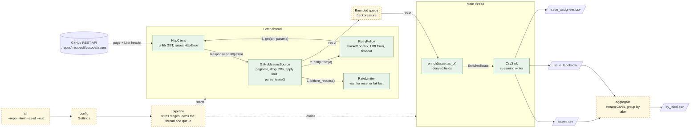

# issueflow

Streams the open and closed issues of `microsoft/vscode` from the GitHub REST API (pull requests excluded), adds four derived fields to each issue, and writes CSV files ready for database import. Python 3.12, standard library plus pytest only.

**Status:** the fetch side (HTTP, retry, rate limit, GitHub source), the derived-field transform and the CSV sink are built and tested. The pipeline, aggregate, config and CLI are designed below and marked `planned`.

## How it works in one minute

1. A **fetch thread** asks GitHub for issues, 100 per page, and follows the `Link: rel="next"` header until the last page.
2. Each request goes through a **rate limiter** (wait for the quota to reset, or stop with a clear message) and a **retry policy** (backoff on 5xx, network errors and timeouts).
3. Pull requests are dropped, `--limit` is applied, and each payload becomes a typed `Issue`.
4. Issues cross a **bounded queue** to the **main thread**, which computes the derived fields and appends rows to three CSV files.
5. A final **aggregate** step streams the CSVs and writes `by_label.csv`.

Every stage is a generator or a queue, so memory holds about one page (100 issues) at a time, not the 19,000+ issues of the full dataset.

## Architecture

`built` boxes are solid, `planned` boxes are dashed.



The same flow in plain text:

```
                    FETCH THREAD                               MAIN THREAD
  ┌────────────────────────────────────────────┐        ┌───────────────────────────────┐
  │ GitHubIssuesSource                         │        │ enrich(issue, as_of)          │
  │   paginate via Link header                 │        │   open_age_days               │
  │   drop pull requests, apply --limit        │ Issue  │   days_since_update           │
  │   parse_issue(raw) -> Issue          ──────┼──────► │   is_unassigned, is_stale     │
  │      │                                     │ bounded│              │                │
  │      │ 1. RateLimiter.before_request()     │ queue  │              ▼ EnrichedIssue  │
  │      │ 2. RetryPolicy.call(attempt)        │        │ CsvSink                       │
  │      ▼ 3. HttpClient.get(url, params)      │        └──────────────┬────────────────┘
  └──────┼─────────────────────────────────────┘                       │ rows
         ▼                                                             ▼
   GitHub REST API                                      issues.csv  issue_labels.csv  issue_assignees.csv
                                                                  │          │
                                                                  └────┬─────┘
                                                                       ▼
                                                  aggregate (planned) ──► by_label.csv
```

### What one page request does

```
GitHubIssuesSource._get(url, params)
  │
  ├─► limiter.before_request()      quota exhausted? sleep until reset if the wait is short,
  │                                 otherwise raise RateLimitExceeded (stop the run)
  │
  ├─► client.get(url, params)       ── 2xx ──► limiter.update(headers) ──► return Response
  │        │
  │        └── HttpError ──► limiter.update(headers), then:
  │              5xx / URLError / timeout ... RetryPolicy sleeps (backoff) and calls again
  │              403/429 rate limited ....... wait via limiter, retry (at most 3 times)
  │              any other 4xx .............. raised at once, never retried
  │
  └─► _pages() yields resp.json, then follows the Link rel="next" URL (no params: the URL carries them)
```

## Data model

`src/issueflow/models.py` defines what each stage hands to the next.

| Type | Fields |
|---|---|
| `Issue` | `number`, `id`, `title`, `state` (`open`/`closed`), `state_reason`, `author`, `created_at`, `updated_at`, `closed_at`, `comments`, `milestone`, `html_url`, `labels` (tuple of names), `assignees` (tuple of logins). All datetimes are timezone-aware UTC. |
| `EnrichedIssue` | `issue`, `as_of`, plus the four derived fields below. |

## Derived fields

All day counts are **whole days, floored**, measured against `as_of` (default: run start, UTC). A timestamp later than `as_of` counts as 0.

| Field | Rule | Edge cases |
|---|---|---|
| `open_age_days` | `as_of - created_at` | Empty for closed issues. |
| `days_since_update` | `as_of - updated_at` | Computed for open and closed issues. |
| `is_unassigned` | `assignees` is empty | A single assignee is enough to make it `false`. |
| `is_stale` | open and `days_since_update > 30` | 30 days 23 hours floors to 30, so it is not stale; 31 days is. Closed issues are never stale. |

## Output CSVs

UTF-8, header row, ISO 8601 UTC timestamps with second precision (`2025-02-01T08:30:00Z`), `true`/`false` booleans, empty string for null. Labels and assignees live in child files so the data imports cleanly into a relational database.

| File | Columns |
|---|---|
| `issues.csv` | `number`, `id`, `title`, `state`, `state_reason`, `author`, `created_at`, `updated_at`, `closed_at`, `comments`, `milestone`, `html_url`, `open_age_days`, `days_since_update`, `is_unassigned`, `is_stale`, `as_of` |
| `issue_labels.csv` | `issue_number`, `label` |
| `issue_assignees.csv` | `issue_number`, `assignee` |

## Bonus: aggregate by label (`by_label.csv`, planned)

One row per label, to show where the backlog is concentrated and neglected.

| Metric | Definition | Why |
|---|---|---|
| `total` | Issues with the label. | Size of the area. |
| `open` | Of those, currently open. | Current backlog. |
| `stale` | Open issues with `is_stale = true`. | Neglected work. |
| `unassigned` | Issues with `is_unassigned = true`. | Ownership gaps. |
| `median_open_age_days` | Median `open_age_days` of open issues. | How long work waits; the median resists a few very old issues. |
| `median_days_to_close` | Median whole days from `created_at` to `closed_at` for closed issues. | Resolution speed. |

## File guide

Files are listed in data-flow order.

### `src/issueflow/models.py` (built)
Frozen dataclasses `Issue` and `EnrichedIssue` (see Data model). Frozen so a stage cannot change data another stage still holds.

### `src/issueflow/sources/base.py` (built)
- `Source.iter_records() -> Iterator[dict]`: the contract every source follows, a lazy single pass over raw records.
- **Why:** the pipeline depends on this protocol, so adding another source (for example GitLab) means writing one new class.

### `src/issueflow/sources/http.py` (built)
- `HttpClient(opener=urlopen, timeout=30, headers=None).get(url, params) -> Response`: one GET with `urllib`. Encodes `params`, drops `None` values, parses the JSON body (empty body gives `None`), and lower-cases header names. Sends a default `User-Agent` because GitHub rejects requests without one.
- `Response(status, headers, json)`: the parsed result.
- `HttpError(status, headers, body)`: raised for every non-2xx response, so callers decide what each status means.
- **Why:** transport only. The `opener` argument lets tests inject a fake instead of using the network.

### `src/issueflow/sources/retry.py` (built)
- `RetryPolicy(max_attempts=5, base_delay=1, max_delay=30).call(fn)`: runs `fn`, retrying transient failures and re-raising the last error when attempts run out. No sleep after the final attempt.
- `delay_for(attempt)`: full jitter, `random() * min(max_delay, base_delay * 2**(attempt-1))`.
- `is_retryable(exc)`: true for `HttpError` with status 500 or above, `URLError` and `TimeoutError`. Every other 4xx, including 429, is never retried here.
- **Why:** full jitter spreads retries so clients do not retry in lockstep. `sleep` and `random` are injected so tests run instantly and deterministically. 429 is left to the rate limiter, which knows when the quota resets.

### `src/issueflow/sources/rate_limit.py` (built)
- `RateLimiter(max_wait=60, clock, sleep)`:
  - `update(headers)` records `X-RateLimit-Remaining`/`X-RateLimit-Reset`, or `Retry-After` (treated as quota 0 until that moment).
  - `before_request()` returns at once if quota remains. If it is exhausted, it sleeps until the reset when the wait is at most `max_wait`, otherwise raises `RateLimitExceeded`.
- `is_rate_limit_error(exc)`: true for a 403 or 429 `HttpError` with remaining quota `0` or a `Retry-After` header. A plain 403 permission error does not match.
- **Why:** unauthenticated GitHub allows 60 requests per hour. Waiting an hour would look like a hang, so long waits fail fast with a message instead.

### `src/issueflow/sources/github.py` (built)
- `GitHubIssuesSource(owner="microsoft", repo="vscode", *, limit=None, per_page=100, client, retry, limiter)`: the GitHub-specific source.
  - `iter_records()`: yields raw issue dicts. Drops pull requests (payloads with a `pull_request` key), counts `limit` after that filter, and stops without fetching a page it does not need.
  - `iter_issues()`: the same stream, mapped through `parse_issue` into `Issue` objects.
  - `_pages()`: first request is `GET /repos/{owner}/{repo}/issues` with `state=all`, `sort=created`, `direction=asc`, `per_page=100`, `page=1`; later pages follow the `Link` header.
  - `_get(url, params)`: combines limiter, retry and the HTTP client as shown in "What one page request does". Rate-limit waits are capped at 3 per page, then the error is raised.
- `next_url(link_header)`: extracts the `rel="next"` URL, or `None` on the last page.
- `parse_issue(raw)`: the only place that knows GitHub's JSON shape. Converts timestamps to UTC, flattens `user`, `milestone`, `labels` and `assignees`, and tolerates null fields.
- **Why:** the `Link` header is GitHub's documented way to paginate. `sort=created asc` keeps pages stable when new issues arrive during a run. Dropping pull requests here is right because a PR is not an issue in our model.

### `src/issueflow/transforms/derived.py` (built)
- `enrich(issue, as_of) -> EnrichedIssue`: pure function that applies the four rules in "Derived fields".
- `_whole_days(earlier, later)`: floored whole days, clamped at 0.
- **Why:** no I/O and no clock, because `as_of` is a parameter. The same input always gives the same output, which makes the stale boundary easy to test.

### `src/issueflow/sinks/base.py` (built)
- `Sink`: the contract every output follows: `write(item: EnrichedIssue)`, `close()`, and use as a context manager.
- **Why:** the pipeline depends on this protocol, so a new format (Parquet, SQLite) is a new sink, not a change to the pipeline.

### `src/issueflow/sinks/csv_sink.py` (built)
- `CsvSink(out_dir)`: opens `issues.csv`, `issue_labels.csv` and `issue_assignees.csv` once, writes the headers, then for every `EnrichedIssue` appends one row to `issues.csv` plus one row per label and per assignee to the child files. Creates `out_dir` if missing and overwrites existing files. `close()` (or leaving the `with` block, even on an error) flushes and closes all three files.
- `issue_row(item)`: formats one `issues.csv` row. Timestamps become UTC with second precision, booleans become `true`/`false`, and nulls become empty strings.
- `ISSUE_COLUMNS`, `LABEL_COLUMNS`, `ASSIGNEE_COLUMNS`, and the file-name constants: the schema in one place, reused by the aggregate step.
- **Why:** writing row by row keeps memory flat. Child files avoid packing several values into one cell, so the CSVs import into a relational database without parsing.

### `src/issueflow/pipeline.py` (planned)
- Runs the source in a **producer thread** that puts `Issue` objects on a bounded `queue.Queue`. The main thread takes them, calls `enrich`, and writes through the sink. A sentinel value ends the queue, and an exception in the producer is re-raised in the main thread so a failed run is never silent.
- **Why:** network waits and disk writes overlap, and the bounded queue stops the fetcher from running far ahead of the writer.

### `src/issueflow/aggregate.py` (planned)
- Streams `issues.csv` and `issue_labels.csv` and writes `by_label.csv` with the metrics above. It keeps only small per-label counters and value lists for the medians in memory, a documented trade-off.

### `src/issueflow/config.py` (planned)
- A frozen `Settings` dataclass: repository, limit, `as_of`, output directory, rate-limit wait cap.

### `src/issueflow/cli.py` (planned)
- The `issueflow` command (`pyproject.toml` entry point `issueflow.cli:main`). Options: `--repo`, `--limit`, `--as-of`, `--out`.

### `tests/` (built for existing modules)
- Mirrors `src/`. Tests inject a fake `opener`, clock, `sleep` and `random`, so they run in milliseconds and never touch the network.
- The suite covers retry counts and give-up, the rate-limit wait and fail-fast paths, Link pagination, PR filtering, limit edge cases, and the stale boundary at 30 versus 31 days.

## Design principles

- **Streaming:** generators and a bounded queue, never a full in-memory dataset.
- **Overlap:** fetching and writing run at the same time in two threads.
- **Deterministic:** `as_of`, the clock, sleep and randomness are injected.
- **Extensible:** a new source, derived field or output format changes one file, because stages meet at small interfaces.

## Run and test

```
.venv/bin/python -m pytest
```

Python 3.12 is required (the code uses `str | None` and generic function syntax). The command `issueflow --limit 200 --out out/` arrives with the planned modules.

Without a token, the GitHub API allows 60 requests per hour, about 6,000 issues at 100 per page. The fetcher fails fast with a clear message instead of waiting out a long reset, and `--limit` keeps a demo run small.
